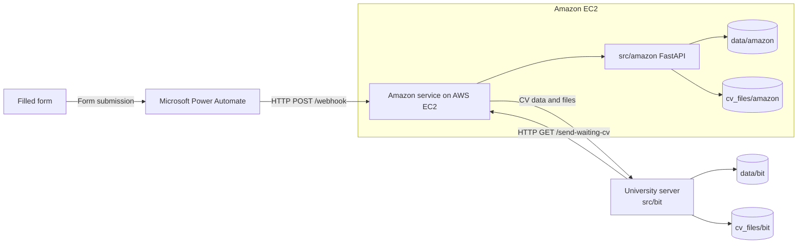

# 📄 CV Webhook Server

A lightweight, containerized **FastAPI** webhook server designed to automate the ingestion, validation, and processing of candidate CV submissions from an external form through Microsoft Power Automate.

The project utilizes a clean **multi-tenant / multi-pipeline architecture**, allowing isolated data schemas, storage, and deployment configurations for different recruitment pipelines or events (specifically tailored for **BIT** and **Amazon** workflows) while sharing core utilities like PDF conversion and base validation models.

---

## ✨ Key Features

* **⚡ Webhook Ingestion:** The Amazon service receives the form payload forwarded by Power Automate through a protected FastAPI webhook.
* **🏢 Multi-Role Architecture:** The `amazon` service receives and stores CVs, while the `bit` service polls the Amazon service over HTTP and saves copies locally.
* **📑 Automated Document Processing:** Downloads and processes uploaded resumes, including automated **PDF-to-image conversion** (`pdf2image` / `Pillow`) for downstream previewing or OCR/AI processing.
* **🛡️ Strict Data Validation:** Leverages **Pydantic** (`base_schemas.py`, `forms_schema.py`) to validate complex, nested webhook payloads before executing CRUD operations.
* **🐳 Isolated Docker Deployments:** Dedicated `Dockerfile` and `docker-compose.yml` configurations per pipeline (`deploy/amazon` and `deploy/bit`) with persistent volume mounting for CVs and structured data.
* **📦 Modern Python Tooling:** Managed with **`uv`** (`pyproject.toml` & `uv.lock`) and supporting Python 3.12+ (the Docker images currently use Python 3.13).

---

## 🏗️ System Architecture



The university server periodically polls the Amazon service over HTTP. After a
successful local save it updates the CV status on EC2 (`/change-pending`); failed
downloads are returned to the waiting queue (`/change-waiting`).

---

## 📂 Project Structure

```text
CV_Webhook_Server/
├── cv_files/                   # Persistent storage for downloaded CV files
│   ├── amazon/
│   └── bit/
├── data/                       # Persistent storage for processed candidate records
│   ├── amazon/
│   └── bit/
├── deploy/                     # Isolated Docker deployment configurations
│   ├── amazon/
│   │   ├── .env.example
│   │   ├── Dockerfile
│   │   └── docker-compose.yml
│   └── bit/
│       ├── .env.example
│       ├── Dockerfile
│       └── docker-compose.yml
├── src/                        # Application source code
│   ├── amazon/                 # Amazon webhook logic, schemas, and FastAPI app
│   │   ├── crud.py
│   │   ├── forms_schema.py
│   │   └── main.py
│   ├── bit/                    # BIT polling client and local storage logic
│   │   ├── crud.py
│   │   └── main.py
│   └── shared/                 # Shared Pydantic schemas and PDF conversion utilities
│       ├── base_schemas.py
│       └── pdf_coversion.py
├── .dockerignore
├── .gitignore
├── .python-version             # Python 3.12
├── pyproject.toml              # Project dependencies and metadata (uv)
├── requirements.txt            # Standard pip dependencies
└── uv.lock                     # Lockfile for reproducible builds
```

---

## 🚀 Getting Started

You can run the services either using **Docker Compose** (recommended for production) or locally using **`uv`** / `pip`.

### Option 1: Running with Docker (Recommended)

Each pipeline has its own isolated Docker configuration in the `deploy/` directory.

**1. Configure environment variables:**
```bash
# For the Amazon pipeline:
cp deploy/amazon/.env.example deploy/amazon/.env

# For the BIT pipeline:
cp deploy/bit/.env.example deploy/bit/.env
```
*(Edit the `.env` files with your specific secrets, ports, or webhook tokens).*

**2. Build and start the chosen container:**
```bash
# Run Amazon webhook server
docker compose -f deploy/amazon/docker-compose.yml up -d --build

# OR run BIT polling service
docker compose -f deploy/bit/docker-compose.yml up -d --build
```

---

### Option 2: Local Development

#### 1. Prerequisites
* **Python 3.12+**
* **`poppler-utils`** (required by `pdf2image` for PDF rendering):
  * Ubuntu/Debian: `sudo apt-get install poppler-utils`
  * macOS: `brew install poppler`

#### 2. Installation
Using **`uv`** (fast, modern package manager):
```bash
uv sync
```

Or using standard `venv` and `pip`:
```bash
python -m venv .venv
source .venv/bin/activate
pip install -r requirements.txt
```

#### 3. Running the services
Run the Amazon webhook service using `uvicorn`:

```bash
# Start the Amazon pipeline API
PYTHONPATH=src uv run uvicorn amazon.main:app --reload --port 8000
```

The BIT service is an HTTP polling client rather than a FastAPI application. Run
it after configuring `EC2_URL`, `API_KEY`, `NGROK_BASIC_AUTH`, `DATABASE`, and
`CV_DIRECTORY`:

```bash
PYTHONPATH=src uv run python -m bit.main
```

Once the Amazon service is running, navigate to `http://localhost:8000/docs`
to view its interactive Swagger UI documentation.

---

## 🛠️ Tech Stack

* **Framework:** FastAPI, Uvicorn
* **Data Validation:** Pydantic, `email-validator`
* **Document & Image Processing:** `pdf2image`, Pillow (PIL)
* **HTTP Client:** Requests
* **Environment & Packaging:** Python 3.12+, `uv`, Docker & Docker Compose